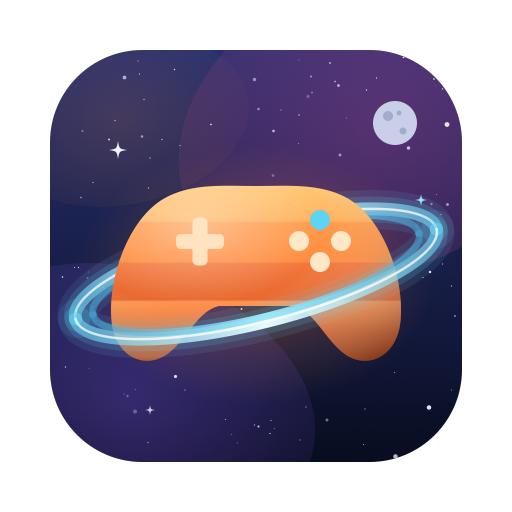
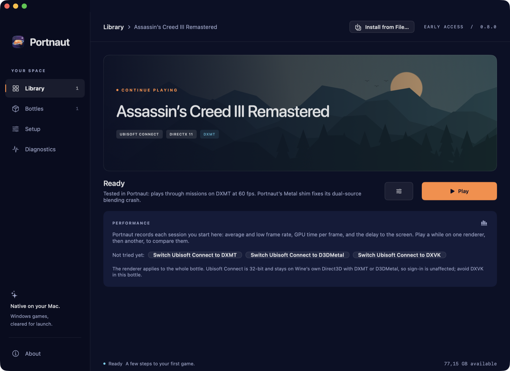
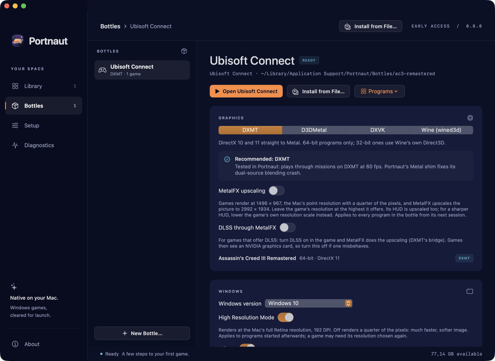
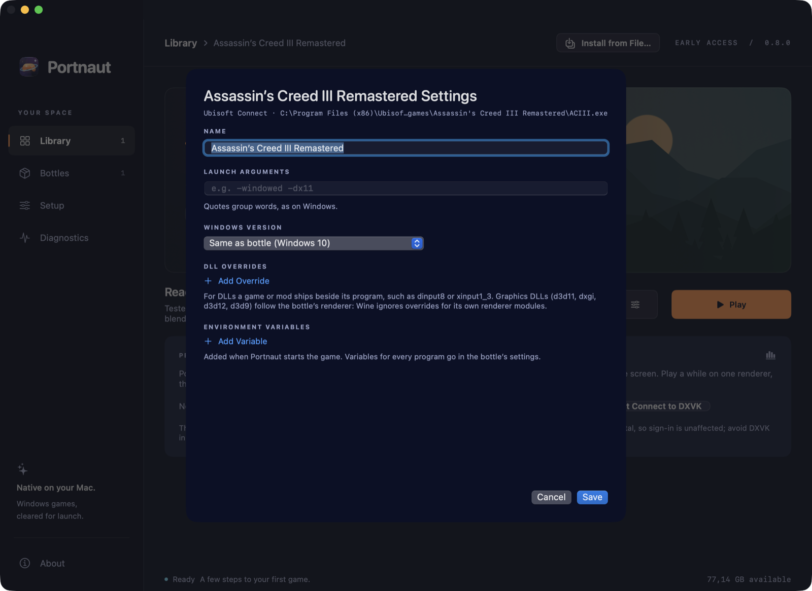
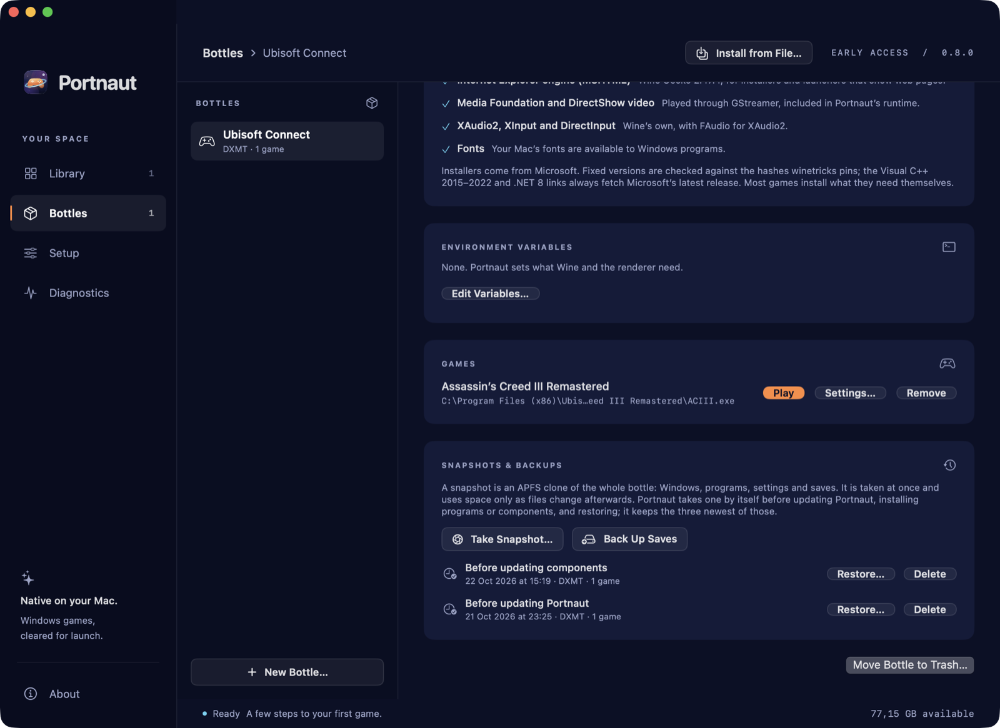
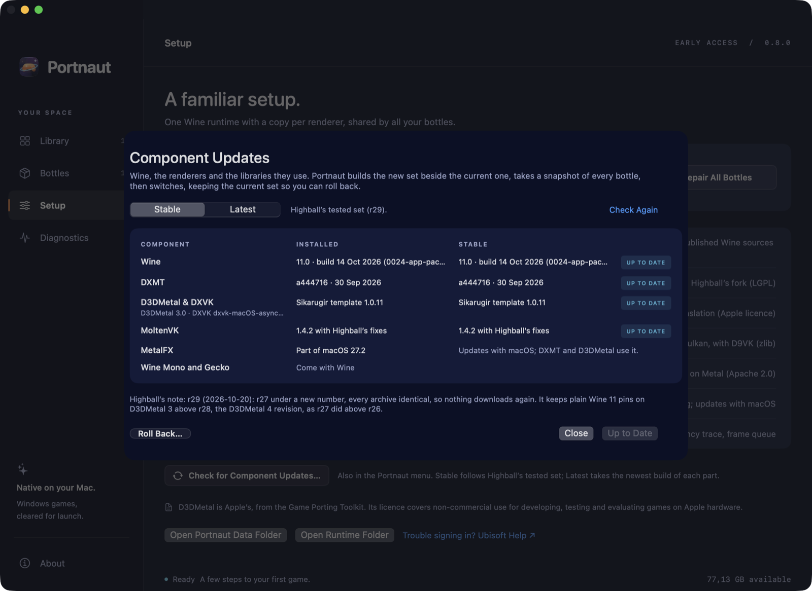

<p align="center">
  
</p>

<h1 align="center">Portnaut</h1>

<p align="center">
  <strong>Play Windows games on your Mac. Free.</strong><br>
  An open-source app for Apple silicon, made by Built by Argo.
</p>

<p align="center">
  
  
  
  
</p>

<p align="center">
  <a href="https://github.com/BuiltByArgo/Portnaut/releases/latest"></a>
  <a href="https://ko-fi.com/A2H229BWWV"></a>
  <a href="https://portnaut.com"></a>
</p>

<p align="center">
  
</p>

Portnaut keeps each game launcher or game in its own **bottle**, a separate Windows environment, and
runs it with Wine and a graphics translator that turns Direct3D into Apple's Metal. It looks at every
game you add and recommends the translator that suits it. In easy mode it sets each game up for you:
install a game and play. Public beta.

## Features

### A bottle for every launcher

Steam, the EA app, Ubisoft Connect, the Epic Games Launcher, Battle.net, the Rockstar Games
Launcher, GOG Galaxy and Amazon Games install in a few clicks, from their publishers' own installers,
or run any Windows installer you choose. Each bottle picks its renderer: **DXMT**,
**D3DMetal**, **DXVK** or Wine's own. Portnaut tells you which one a game should use and why.

<p align="center">
  
</p>

### Easy mode: install a game and play

New bottles start in easy mode. When you press Play, Portnaut switches the bottle to the renderer that
suits the game (the one measured fastest on your Mac, else the one it was tested on, else the one its
files suggest) and backs up your saves first. Advanced settings stay one click away.

### Will It Run?

Check a game before you buy or download it: about 13,000 games with Mac reports, anti-cheat and Linux
players' results, from Highball's open compatibility database. Every game in your library shows its
verdict, and Portnaut warns you when Steam starts downloading a game that can't run, before the
download finishes. The check happens on your Mac; nothing about what you play is sent anywhere.

### Find My Best Setup

Portnaut plays a game once on each renderer it can use, measures every round on your Mac, and keeps
the fastest. Easy mode then starts the game there.

### Couch Mode

Your library, full screen on a TV, driven by a controller: choose with the D-pad, A to play, B to
leave. Portnaut comes back to the front when the game closes.

### Settings for each game

Per game: launch arguments, the Windows version the game sees, DLL overrides for mods, and
environment variables.

<p align="center">
  
</p>

### Snapshots and save backups

Portnaut snapshots a whole bottle before every risky change, so it can always go back. It can also
back up your game saves to your Documents folder before every game, keeping the ten newest copies.

<p align="center">
  
</p>

### Components that stay current

Wine and the renderers update from inside the app, with a snapshot first and a way back.

<p align="center">
  
</p>

### And also

- **Games appear by themselves:** games from Steam, the EA app, the Epic Games Launcher, GOG and
  Amazon Games join the library as they install; **Find Programs** lists anything else.
- **Controllers:** recognised through SDL (Xbox, PlayStation, Switch and most others) and shown to
  games as Xbox controllers, with a test panel.
- **Windows components:** Visual C++ runtimes, .NET Desktop Runtime 8 and the DirectX 9–11 helper
  libraries, from Microsoft.
- **Performance records:** frame rate, lows and GPU time for every session, to compare renderers.
- **Experimental:** MetalFX upscaling, and DLSS through MetalFX for games that offer DLSS.

Tested most with Assassin's Creed III Remastered through Ubisoft Connect: missions play at about
60 fps on an M4 Pro.

## Get started

**You need:**
- a Mac with Apple silicon (M1 or later)
- macOS 14.6 or later
- about 3 GB of free space, plus room for your games
- **Rosetta.** Portnaut tells you if it's missing; to install it, open Terminal and run
  `softwareupdate --install-rosetta`.

1. **Download** `Portnaut-<version>.zip` from the
   [latest release](https://github.com/BuiltByArgo/Portnaut/releases/latest), open it, and move
   **Portnaut** to your Applications folder.
2. **Open Portnaut.** It isn't notarized by Apple yet, so macOS stops it the first time:
   1. Open **System Settings › Privacy & Security**.
   2. Scroll to the message about Portnaut and choose **Open Anyway**, then confirm.

   After that it opens normally.
3. **Choose Prepare Portnaut.** It downloads Wine and the renderers once (a few hundred MB), checks
   them, and sets them up in `~/Library/Application Support/Portnaut`.
4. **Bottles › New Bottle…**: pick a launcher or an empty bottle. Install the launcher, sign in, and
   install a game.

Step-by-step guides for Steam, the EA app and Ubisoft Connect, a comparison of the renderers, and
answers to common questions are on **[portnaut.com](https://portnaut.com)**.

To check a download, compare `shasum -a 256 Portnaut-<version>.zip` in Terminal with the checksum on
the release page.

## What Portnaut downloads

Portnaut itself contains only its own code. When you ask it to, it downloads:

| What | From | Licence |
| --- | --- | --- |
| Wine 11, DXMT and MoltenVK | Highball's public releases on GitHub (Wine built from the sources CodeWeavers publishes) | LGPL, Apache-2.0 |
| D3DMetal, DXVK, GStreamer, SDL and support libraries | The Sikarugir project's public template on GitHub | Apple's Game Porting Toolkit licence for D3DMetal; open-source licences for the rest |
| Game launchers (Steam, the EA app, Ubisoft Connect, the Epic Games Launcher, Battle.net, the Rockstar Games Launcher, GOG Galaxy, Amazon Games) | Their publishers: Valve, Electronic Arts, Ubisoft, Epic Games, Blizzard, Rockstar Games, GOG and Amazon | Their own terms, which their installers show |
| Visual C++, .NET and DirectX components | Microsoft | Microsoft's terms; Portnaut asks you to accept them first |
| The compatibility list behind Will It Run? (a copy ships in the app) | Highball's public database: [highball-db](https://github.com/gauthierpiarrette/highball-db) | CC0; predictions from ProtonDB's Linux reports under the ODbL; the anti-cheat list from Are We Anti-Cheat Yet? under MIT |

Every runtime download is checked against a published SHA-256 checksum before it's installed. Full
details are in [THIRD-PARTY-NOTICES.md](THIRD-PARTY-NOTICES.md).

D3DMetal is Apple's, from the Game Porting Toolkit. Apple licenses it for non-commercial use in
developing, testing and evaluating games on Apple hardware. Portnaut is free and non-commercial, and
installs it unmodified.

## Privacy

No account, no analytics, no tracking. Portnaut connects to the internet only:
- for the downloads above
- when you open Component Updates, to ask GitHub what's new and to fetch the newest compatibility list

Will It Run? and every game's verdict are worked out on your Mac from that list: Portnaut never sends
what you search for or play.

Its logs stay on your Mac. A diagnostics report is a file you choose to save and send.

## Good to know

- Games with kernel-level anti-cheat (for example EA Sports FC, Battlefield, Fortnite, Call of Duty
  and GTA Online) don't run under Wine, in Portnaut or anywhere else. Some online games may not allow
  Wine in their terms.
- DirectX 12 games need the D3DMetal renderer.
- The Rockstar Games Launcher doesn't start on D3DMetal, so Rockstar bottles use DXMT or DXVK. In Red
  Dead Redemption 2, choose Vulkan in its graphics settings.
- The windows of Steam, Battle.net, Rockstar's Social Club, GOG Galaxy and Amazon Games are drawn in
  software; games are not.
- New and not yet tried with real games: Find My Best Setup's rounds, and Couch Mode with a controller.
  Reports are welcome.
- Portnaut is in public beta: expect rough edges, and keep backups of saves you care about.

## Build from source

**You need:**
- macOS 14.6 or later on Apple silicon
- Apple's Command Line Tools with Swift 6 or later. Xcode isn't needed.

```sh
bash scripts/test.sh     # runs the tests
bash scripts/build.sh    # builds build/Portnaut.app, ad-hoc signed
open build/Portnaut.app
```

`bash scripts/package-release.sh` builds the app and writes `Portnaut-<version>.zip` and its SHA-256
to `release-assets/`. `bash scripts/update-compatibility.sh` refreshes the compatibility list in
`Compatibility/`, which the build copies into the app.

| Folder | What's in it |
| --- | --- |
| `Sources/PortnautCore` | Bottles, Wine, renderers, components, snapshots and updates |
| `Sources/Portnaut` | The SwiftUI app |
| `Sources/PortnautDoctor` | `portnaut-doctor`, a command-line helper the app carries in `Contents/Helpers` |
| `Shims` | A small Metal shim loaded into games |
| `Tests` | The test suite |
| `Icon` | The app icon, drawn into every size by `scripts/make-icon.swift` |
| `Compatibility` | Highball's compatibility list and its licences, shipped in the app |

## Support

Email **[builtbyargo@proton.me](mailto:builtbyargo@proton.me)**, or in Portnaut choose
**Help › Email Built by Argo Support…**. For a problem, attach a report from
**Diagnostics › Export diagnostics…** and say what you were doing.

## Licence

Portnaut is free software under the MIT licence, © 2026 Built by Argo ([LICENSE](LICENSE)). This
repository holds its full source code. The components it downloads keep their own licences
([THIRD-PARTY-NOTICES.md](THIRD-PARTY-NOTICES.md)).

<sub>Portnaut is an independent project, not affiliated with or endorsed by Apple, Valve, Electronic
Arts, Ubisoft, Epic Games, Blizzard Entertainment, Rockstar Games, GOG, Amazon, Microsoft, CodeWeavers,
Highball or Sikarugir. Steam, EA, Ubisoft Connect, Epic Games, Battle.net, Rockstar Games, GOG GALAXY,
Amazon Games, Assassin's Creed, Apple, Mac, Metal and MetalFX are trademarks of their owners.</sub>
